# Noline

> 一个克制、无描边的 Typecho 主题，配一个可选的 REST 接口插件。当前版本 **1.30.1**。

Noline 主张「无描边卡片」与「设计令牌驱动」：层次靠留白、圆角和一套统一的颜色令牌划分，
不靠重描边和强阴影。所有颜色集中在 `:root`，浅色深色各一套，强调色在后台填一个十六进制就够，
深色模式会按它自动算出更亮的变体，换肤不用翻文件。

---

## 这个仓库里有什么

| 路径 | 内容 |
|---|---|
| 仓库根目录 | **主题本体**，目录结构就是 Typecho 的主题目录，可以直接当 `usr/themes/noline` 用 |
| `plugins/NolineApi/` | 可选插件：对外接口（主题设置 / 体重 / 买菜记账）+ 后台「主题管理」页 + GitHub 一键更新 |
| `APP-API-SPEC.md` | 给 App 开发者的接口规格书（端点、字段、状态码、客户端实现要求） |
| `_dev/` | 静态检查脚本与打包脚本，**不进发布包** |
| `docs/screenshots/` | 下面那几张图，由 `_dev/shots.py` 从模板渲出来，**不进发布包** |

发布包是 Release 附件 `noline.zip`（由 `_dev/build.py` 生成），不是仓库 ZIP 下载。
包里有**两个根**：`noline/` 落到 `usr/themes/noline`，`plugins/NolineApi/` 落到
`usr/plugins/NolineApi`——在线更新一次把主题和插件一起换掉，不留版本错配的那一半。

## 长什么样

首页（浅色 / 深色）：

| | |
|---|---|
| 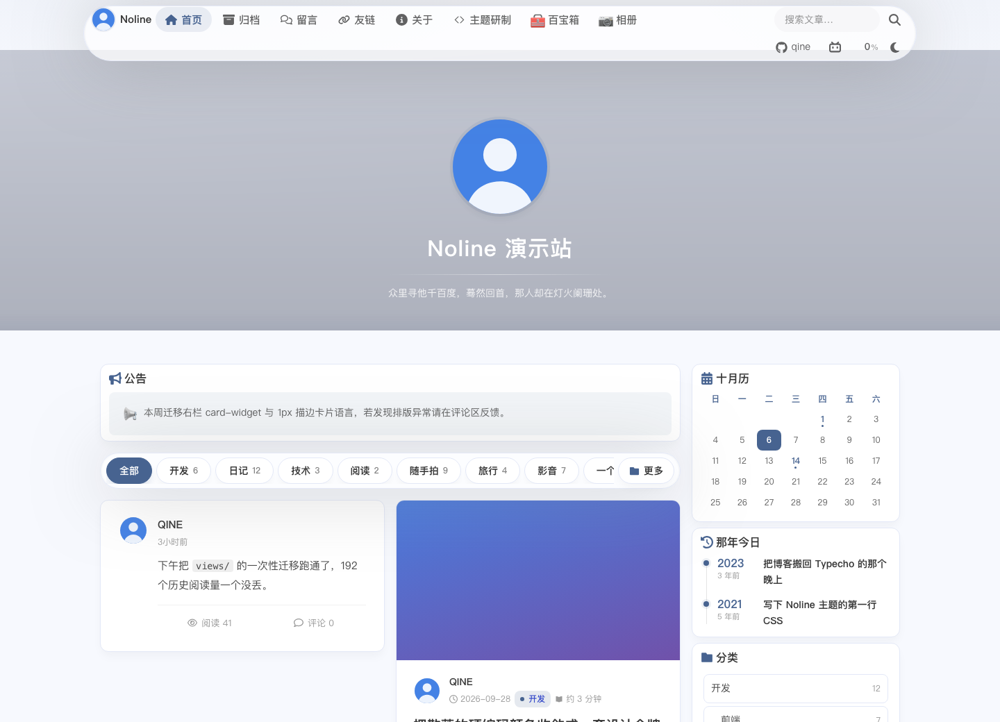 | 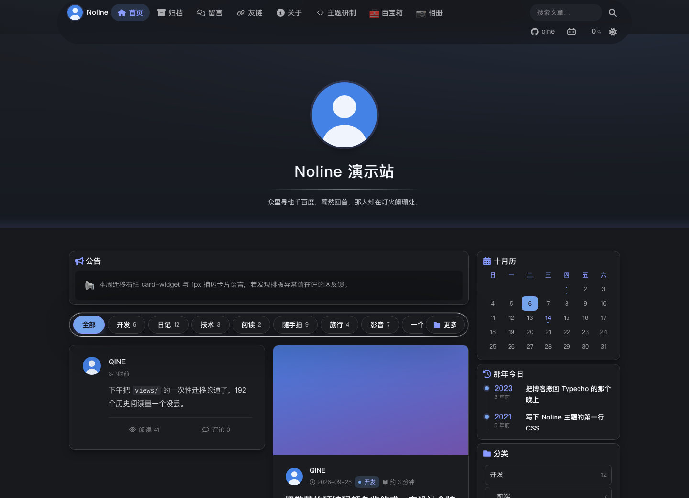 |

桌面模式（首页底栏那颗「桌面」按下去，信息流里的卡片就变成有碰撞体积的方块：
能拖着走、会互相压、落到底板上会歪着倒；「摇晃」把整桌掀起来，松手它们自己重新堆好；
关掉桌面模式位置还留在原地，下次进来接着是那堆）。浅色 / 深色 / 刚摇晃完：

| | | |
|---|---|---|
| 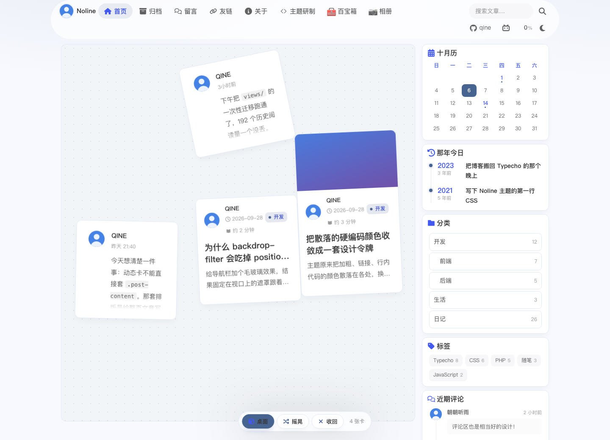 | 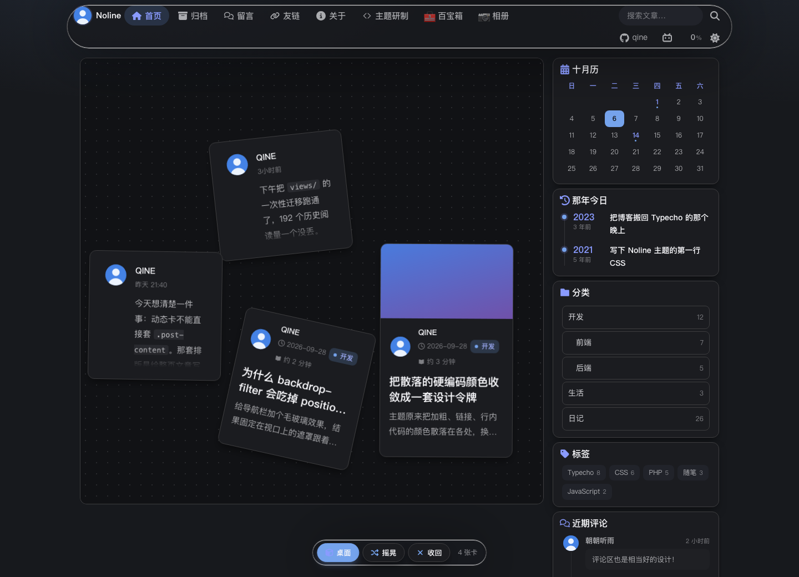 | 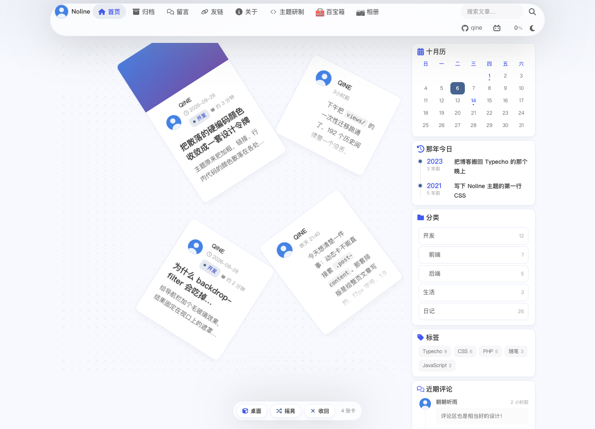 |

移动端（390px，卡片收小到 42vw，字号照旧不降）：

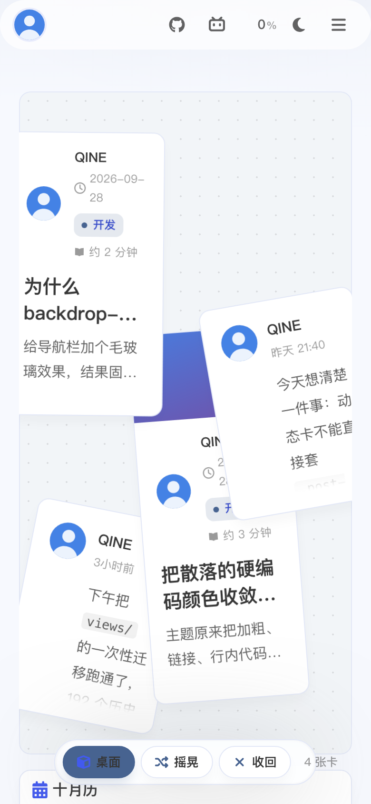

文章页：

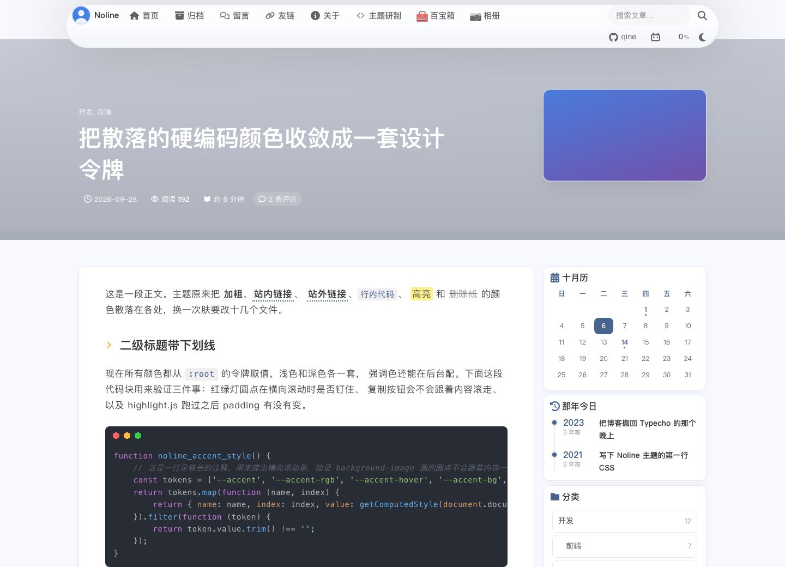

健康记录页（体重/BMI 趋势，数据来自 NolineApi 插件）：

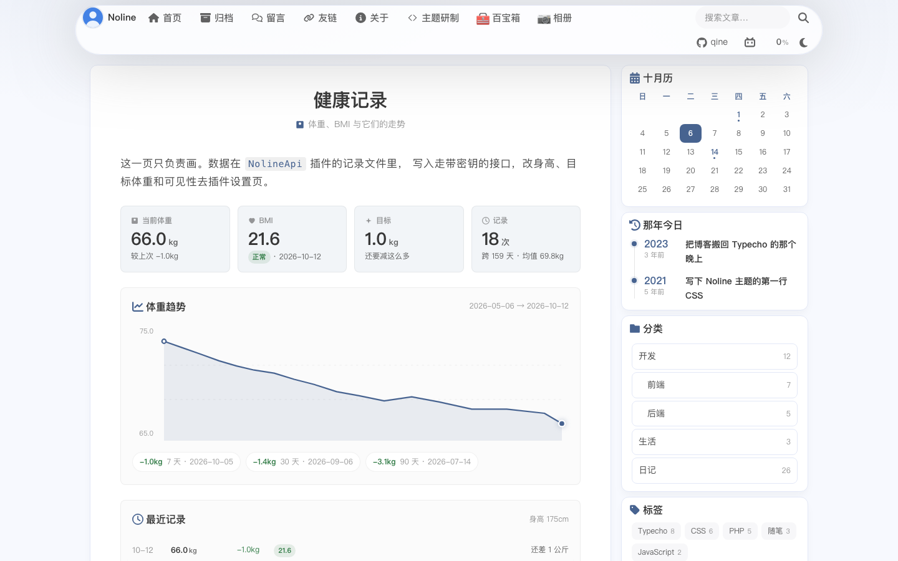

买菜记账页（本周/本月/累计开销、近 7 个月柱、本月分类占比、流水，数据同样来自插件）：

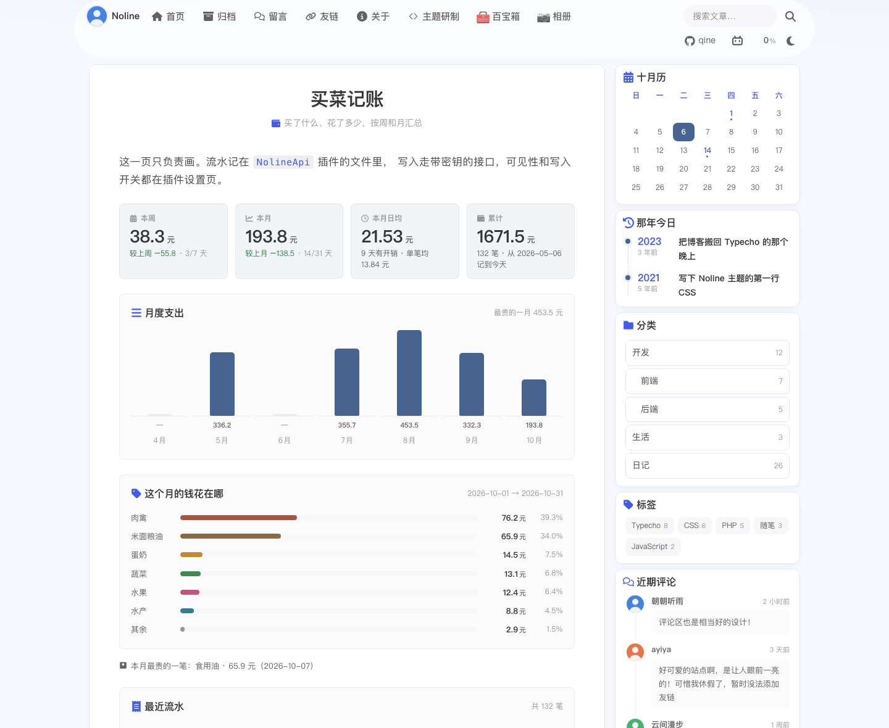

项目展示页（模板自己画自己：主题版本、端点数、那五格颜色都是这一页当次请求现取的，
深色那一张里颜色会跟着翻，因为每一格挂的都是变量而不是色值）：

| | |
|---|---|
| 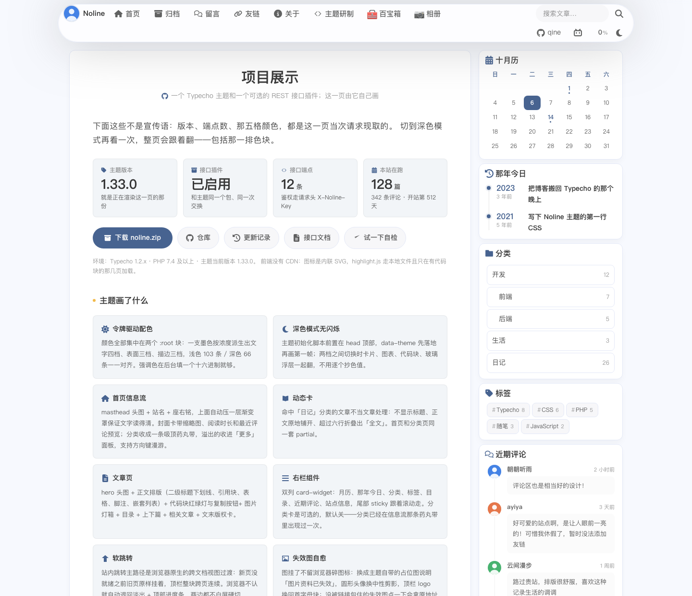 | 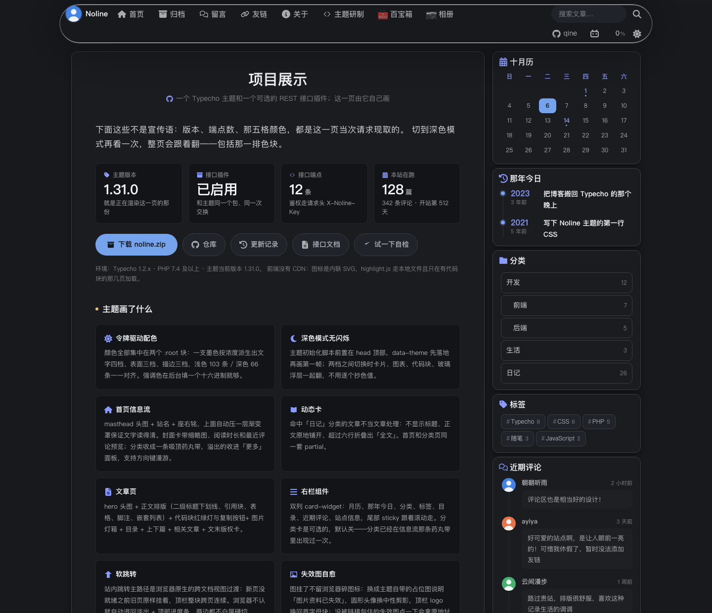 |

移动端首页与项目展示页（390px，首页分类条靠手指横滑，所以没有桌面端那颗「更多」）：

| | |
|---|---|
| 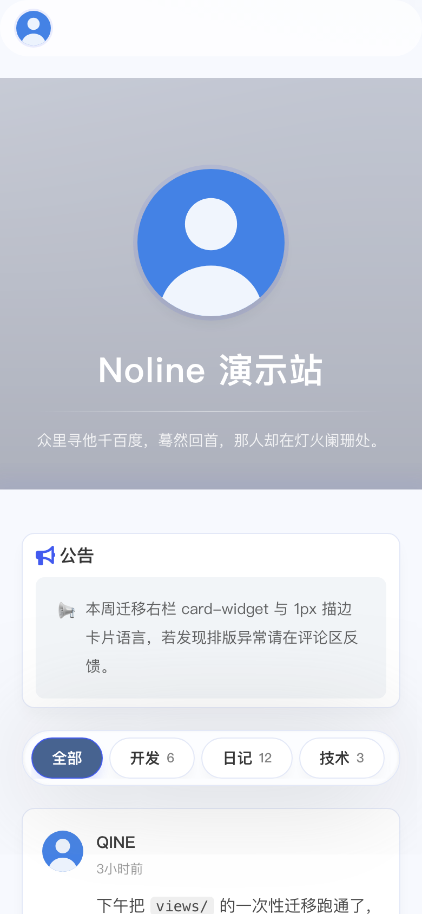 | 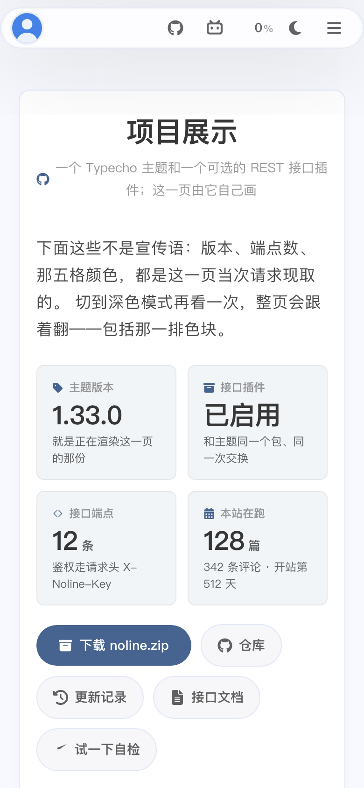 |

> 这几张图不是线上站点的照片，是 `_dev/shots.py` 用无头 Chrome 渲 `_dev/mkpreview.py`
> 生成的静态夹具得到的——数据是示例数据，模板一改重跑一遍图就跟着改，不会烂在仓库里。

## 环境

- Typecho **1.2.x**（写法对着 1.2.1 源码核实过：`index.php:begin` 钩子、`admin/menu.php:navBar`、
  `Widget_Options` 每请求摊平 `theme:*` 配置的行为）
- PHP **7.4+**（主题与插件都没有 PHP 8 专属语法）
- 插件是可选的。不装插件就没有健康记录页和记账页的数据、没有接口、没有后台「主题管理」页，
  主题其余部分照常工作。

---

## 特性

### 设计系统
- 单一墨色 + 透明度派生的层级令牌，浅色 103 条 / 深色 66 条，两边色彩令牌一一对齐。
- 根字号旋钮（rem 化）：密度是全局可调的一个值，**移动端不降字号**，只收留白。
- 顶栏 `backdrop-filter` 玻璃化；主题初始化脚本前置，深色模式无闪烁。
- 完整 `aria-*`、`sr-only` 辅助文本，尊重 `prefers-reduced-motion`。

### 首页
- masthead 头图 + 站名 + 座右铭，上面自动压一层渐变罩保证文字读得清。
- 信息流封面卡（缩略图 + 阅读时长 + 最近评论预览）、吸顶分类药丸条，溢出分类收进「更多」面板
  （支持方向键漫游）。
- 命中「动态分类」的文章渲染成微博式动态卡：不显示标题、正文原地铺开、超过 6 行折叠出「全文」。
- 下一页预取：滚动接近底部时提前取好下一页，翻页不留白屏。
- **桌面模式**（默认关闭）：卡片变成有碰撞体积的方块，能拖动、会互相压、摇晃后自己堆好。
  物理用 vendored 的 matter-js，只在按下开关时才懒加载那一份脚本；位置按文章 cid 存进
  `localStorage`，关掉再开还是那一堆。窄屏只留拖动和摇晃、卡片收小，字号不动。
  文章不足 4 篇时整块入口不渲染。

### 文章页
- hero 头图 + 正文排版（二级标题下划线、引用块、表格、脚注、图片圆角、嵌套列表）。
- highlight.js 高亮、红绿灯圆点钉住横向滚动、复制按钮不随内容滚、无语言代码块浅色兜底。
- 图片灯箱、回到顶部、相关文章、文末版权卡、上下篇与标签。
- **失效图自动顶替**：图挂了不留浏览器碎图标，换成主题自带的占位图说明「图片资料已失效」。
  圆形头像换中性剪影、顶栏 logo 换回首字母块；没被链接包住的失效图点一下会拿原地址重试。
- 评论区：表单 + 嵌套回复 + 待审状态 + 评论内独立代码块样式。

### 右栏
- 双列 `card-widget` 骨架：月历、那年今日、分类、标签、目录、近期评论、站点信息；
  其中分类卡是可选的（后台开关，默认关——分类已经在信息流顶上那条吸顶药丸条里出现过一次）。
- 尾部 sticky，滚动时跟着走。
- 重查询（分类统计、那年今日等）**按天缓存**到 `usr/uploads/noline_cache`，发新文章会主动失效。

### 买菜记账（配合插件）
- 一笔记「哪天、买了什么、多少钱、在哪买的、算哪一类」，分类固定 8 项：蔬菜 / 水果 / 肉禽 / 水产 / 蛋奶 / 米面粮油 / 调料 / 其他。
- 概览四格：本周 / 本月 / 本月日均 / 累计。周按 ISO 周（周一起算）、月按自然月，「较上周 / 较上月」的涨跌由插件算好，页面不再自己减一遍。
- 近 7 个月柱状（插件会补零，整月没买菜也照样出现一根贴地的）、本月分类占比条、本月最贵的一笔、按天分组的最近流水（一天一组，组头给当天合计和星期）。
- 「本月日均」的口径是**有开销的那几天**，不是自然日：三天做一次菜就按三天算，不是按当月过了几天算。
- 主题只管画。数据存在插件的记录文件里，写进去只有带密钥的接口一条路，页面和接口各读各的、互不复制。
- 页面可见性在插件设置里单独一个开关（默认所有人可见），它只藏这一页，不影响接口能不能访问。

### 项目展示页（自述）
- `showcase.php` 是一页用主题自己画的项目说明：主题版本读 `NOLINE_VERSION`、端点数读那张表、
  文章/评论/开站天数走 `noline_site_stats()`（按天缓存）、强调色读后台 `accentColor`，
  五格色块挂的是 CSS 变量——所以它报的数就是这台站当前真实的数，不是抄来的一份。
- 装了插件与没装插件是两支：没装时概览格变灰、自检按钮不出现、接口清单上方给一段空态提示，
  页面照样能开。这一页不依赖插件。
- 末尾那段「给你自己看的」只在登录后出现，讲的是版本号四处对齐和推 tag 发版那条路。

### 页面模板
| 模板 | 用途 |
|---|---|
| `showcase.php` | 项目展示页，用主题自己介绍主题和插件；版本、端点数、颜色、站内计数全是当次现取的 |
| `dcument.php` | 归档页，一次列全文章（代价：查询数 O(文章数)，文章上千会慢） |
| `xiaoshi.php` | 单分类页，靠页面的自定义字段 `category` 指定分类缩略名 |
| `links.php` | 友链页，依赖 Links 插件；没装时只显示提示，不硬编码站点列表 |
| `health.php` | 健康记录页，体重/BMI 折线与统计，数据来自 NolineApi 插件 |
| `bills.php` | 买菜记账页，周/月/累计开销、月度柱、分类占比与流水，数据同样来自 NolineApi 插件 |
| `404.php` | 带空态插画的错误页 |

### 交互与细节
- 站内跳转是「软」的，主路径用浏览器原生的**跨文档视图过渡**：新页没就绪之前旧页原样挂着，
  顶栏（含头像）整块跨页连续、不重建也不重新解码，看起来就是同一块从来没变过。
  主题自己在 `themeInit` 里发 `Cross-Origin-Opener-Policy: same-origin`（这条过渡的硬前提），
  发不出去、或者浏览器不认这条 at-rule（Firefox 目前只支持同源同文档）时，
  自动退回下面那套淡出，不会变成白屏硬切。
- 退路那套也还在：淡出 + 顶部进度条 + 内容就绪再揭示，同样不白屏硬切，也没上 PJAX。
- 搜索快捷键 `⌘K` / `Ctrl+K` / `/`，按断点显示不同的角标文案。
- 各处空态有自绘图标 + 文案（首页 / 归档 / 健康页各一枚，记账页还多两枚：没装插件、页面被设成仅自己可见），不是一行灰字；404 页有插画。

### SEO 与性能
- `canonical` + Open Graph + Twitter card + JSON-LD。
- CSS 走 `.min.css`（压缩后 `design.css` 130 KB → 70 KB），带版本号 `?v=x.y.z`  busting。
- `design.css` 和顶栏头像在 `<head>` 顶部就 `preload`：头像那个 `` 排在几百行 HTML 之后，
  不提前起请求就会在换页那一瞬闪出一块空位。
- 站点头像**转存成站内文件**（`usr/uploads/noline_avatar/`，文件名带原地址哈希）。
  Gravatar 镜像发的是 `cache-control: max-age=300, no-cache`，每开一张新页都要先 304 问一次才敢画；
  转存之后它是站内静态图，浏览器直接命中缓存。目录不可写、抓取失败或超过 512 KB 都原样退回外部地址，
  失败只记一笔、六小时内不再重试（评论头像不转存：那是别人的一张张图，数量和时效都不该由主题背）。
- 浏览量去重 + 爬虫 UA 过滤，计数落在 `usr/uploads/noline_views/<cid>.txt`。

---

## 安装

1. 下载 Release 附件 `noline.zip`（或在仓库里执行 `python3 _dev/build.py`），解压到
   `usr/themes/noline`。
2. 后台「控制台 → 主题」启用 Noline，到「设置外观」里填这 14 项：
   站点头像地址、博主名字、座右铭、首页头图、强调色、动态分类、导航图标、首页公告、
   右栏分类卡、GitHub 显示名、GitHub 链接、Bilibili 显示名、Bilibili 链接、站点底部版权。
3. 想要那几个页面就在后台「新建页面」里选对应模板：项目展示选「项目展示」（slug 建议 `showcase`），
   健康记录页选「健康记录」（slug 建议 `health`），记账页选「买菜记账」（slug 建议 `bills`）。
   三张页面都不存数据，删掉只是没了入口，记录还在插件的文件里。
4. **`views/` 目录别删**：里面是历史浏览量的兜底文件。新计数写在
   `usr/uploads/noline_views/`，找不到就读 `views/`，删了全站计数会从 0 重来。

后台「设置外观」的 14 项就是接口能读写的全部字段，一一对应，没有隐藏项。

## 可选：NolineApi 插件

1. 把 `plugins/NolineApi` 整个目录拷到 `usr/plugins/`。
2. 后台「插件」里启用，填接口密钥（明文存即可，接口靠请求头 `X-Noline-Key` 校验）。
3. **不需要「停用 → 再启用」**：插件对外只挂三条钩子——`index.php:begin`（前台自愈的落脚点）、
   `admin/menu.php:navBar`（顶栏的「主题管理」链接 + 深色开关）、`admin/header.php:header`
   （后台皮肤的那份 CSS/JS，以及编辑器图床面板要用的配置）。图床面板**不再由 PHP 拼 HTML**：
   header 只输出一段 `window.NL_CR` 和静态的 `assets/admin.js`，面板由 JS 在
   `#upload-panel` 顶上现搭，所以核心那个附件面板的 PHP 出什么问题都不会连累图床。
   老版本注册过的那几条不会因为升级而补上——插件每次路过 `index.php:begin` 和
   `admin/menu.php:navBar` 都会拿数据库里的登记和当前代码比一遍，对不上就当场
   按核心自己的语义重登记（`Plugin::deactivate()` → 重新 `factory()` → `activate()` → 写回
   `plugins` 那一行），不碰设置、也不要求你去插件页点任何东西。
   **唯一的前提**：这两个入口钩子不能在同一次发布里同时消失或改名，否则自愈没有落脚点。
   到底登记成没登记，不用猜：「主题管理」页有一节「后台钩子自检」，逐条列出钩子名 +
   已登记/未登记，外加「后台皮肤开/关」「图床设置填没填齐」。
4. 后台顶栏点「主题管理」，那一页有：14 项主题设置的可视化编辑、接口状态与自检、
   后台钩子自检、GitHub 更新与回滚、接入 Cloudreve 的图床上传。
5. **整个后台会换成主题那套视觉**，由 `admin/header.php:header` 注入一份 `assets/admin.css` 实现，
   接在核心三份样式表后面，不用 `!important`、不动核心文件。强调色读的是「设置外观」里那一项，
   所以后台和前台同色。改的是骨架不只是配色：
   - 顶栏改成悬浮的玻璃胶囊条（窄屏收成抽屉），页面底色带一层前台那种暖光晕；
   - 标题、分组名、卡片抬头统一加金点，和前台的 `.card-title` 一个配方；
   - 列表页的表格按前台信息流重排成卡片：`assets/admin.js` 给每个 `<td>` 写上 `data-label`
     （列名取自表头），CSS 把 `<tr>` 变成 flex 卡、`<td>` 变成带小标签的字段，最左边那个有列名
     的格子当主格；勾选、悬停抬起、空态、分页药丸都跟着走；
   - 写文章页：标题输入框抬成 hero、工具条/预览/正文按核心顺序排好、侧栏选项卡成药丸，
     图床面板接在核心附件面板顶上；
   - 登录页、通知条（保留 `error/notice/success` 的语义色，不被卡片白底洗掉）跟着同一套令牌。
   深色开关在顶栏，选择记在 `localStorage`，页面绘制前就同步写好，不会先白一下再黑。
   所有「先藏起来」的规则都挂在 `html.nl-js` 后面，关掉 JS 也只是没动画，不会少内容。
   - **1.2 和 1.3 两套后台标记都吃得住**：1.3 动了骨架——`<div class="main">` 换成 `<main>`、
     `.typecho-table-wrap` 整层删掉、页头的「新增」从 `<h2>` 里挪到外面、列表页的批量操作条从
     `<div>` 变成 `<form>`、空态从 `<h6 class="typecho-list-table-title">` 变成 `<td class="none">`、
     勾选高亮改用 `li:has(input:checked)`。这些位置皮肤都是两条选择器并写，不做浏览器嗅探，
     也不靠 `!important`。
   不喜欢可以在插件设置里关掉「后台皮肤」——只是不套这套样式，核心功能一样不缺，
   图床上传照旧能用。
6. 记账没有后台录入表单，**写入只有接口一条路**（插件设置页只管可见性和开关，主题页只画不能写）。
   所以要用记账就得走 `POST /api/bills/records`（自己 curl、或者用 `APP-API-SPEC.md` 对接的 App）。
   插件设置里的「数据写入（健康 / 记账）」默认是**只读**，记不进去先去看这一项。
   一条流水有个 `YYYYMMDD-NNN` 形式的 id，改和删都靠它；`POST` 是**永远新增**，同一天记两笔就是两笔，
   这点和健康数据的「按天覆盖」相反，别把体重那套写法套过来。
7. **主题与插件一起自动更新，默认开着**：后台路过任意一个页面时查一次（结论缓存 6 小时，两轮之间至少隔
   1 小时），发现 Release 里有新版本就当场下载、验收，把**旧主题和旧插件各整份**挪进
   `usr/uploads/noline_backup/<版本>-<时间>/{theme,plugin}`，再让新版本顶上，不需要点任何东西；
   只有管理员登录的后台请求会触发。交换那几十微秒里撞上的前台请求会吃到一次错误，中途被打断
   （超时/断电）会自己把备份搬回原位——**成对交换要么两边都成，要么两边都退回旧版本**，
   退不干净就把待办留着下次路过再试，历史版本全留在备份目录里可回滚（回滚同样成对）。
   `usr/plugins` 不可写时这一轮只换主题，页面上会写明插件停在旧版本。
   不放心就在插件设置里改成「只提示，我自己点」。**它不判断 Release 本身是好是坏**，
   发布前自己验一遍。
8. **连不上 GitHub 的站点填「主题更新镜像」**（插件设置里那个多行框，一行一条，最多 8 条）。
   顺序永远是 **GitHub 直连优先**，只有直连连不上 / 超时 / 被限流 / 回 5xx 才一条条退到镜像；
   试过不通的镜像进 30 分钟冷却，不会拿每个后台页面去撞它。三种写法：
   **纯前缀**（`https://gh-proxy.com/`，插件把整条 GitHub 地址拼在后面，检测和下载都能用）、
   **含 `{api}`** 的当检测模板、**含 `{tag}` 或 `{asset}`** 的只当下载地址（适合只镜像了包的自有 CDN）。
   预置的三条只有 `gh-proxy.com` 代理了 GitHub API，另两条只代理附件——
   这没关系，检测不通就算这条没用，下载那步它们能顶上。
   **token 只发给 `api.github.com`，绝不发给镜像**；附件地址一律按 repo + tag 自己拼，
   不用镜像回的 JSON 里那个 `browser_download_url`。
   摘要可信度是分开的：只有直连拿到的 sha256 才算可信，**只从镜像检测到新版本时自动覆盖会停住**
   （镜像要改包，连摘要也能一起编），并在页面上写明走的哪条出口，等你自己点确认；
   接口、页面和手动升级都不受影响。
9. 图床：在插件设置里填 Cloudreve 地址和那个网盘账号的 **邮箱 + 密码**，启用后写文章/写页面的
   附件面板顶部会多一个「图床」框，选文件、粘贴截图或拖图片进去都能上传，传完自动把直链按
   当前编辑器形态（Markdown 或富文本）插进正文，附带「打开 / 复制」两个按钮。
   Typecho 自带的附件上传一点不动，两者并存。
   插件只在需要时登一次：登录带回来的会话缓存在 `usr/uploads/noline_api/cloudreve.php`，
   v4 的 access 默认只活 1 小时，到期前用同一串 refresh token 续，续不动（在网盘那边改了密码、
   退出过登录都会让 refresh 作废）就重新拿邮箱密码登一次——所以你在 Cloudreve 里改了密码
   也不需要回来补任何东西。**邮箱、密码和令牌都只待在服务端，浏览器请求先到插件、
   由插件加上 `Authorization` 再转发给 Cloudreve**，所以这条链路不要求同源以外的任何凭据。
   两道坎插件绕不过去，命中会直接把话说清楚：**实例开了登录验证码**（请求在进业务逻辑前就被挡下）、
   **账号开了两步验证**（登录只回一个会话 id，动态码只在人手上）——要么关掉它们，
   要么给图床单独建一个不开两步验证的账号。

接口端点（细节全部在 `APP-API-SPEC.md`）：

```
GET    /api/ping                  连通性自检，不需要密钥
GET    /api/theme                 站点门面 + 14 项主题配置 + 由强调色推出的配色
PUT    /api/theme                 写主题配置（另一个开关控制，body 只带要改的键）
GET    /api/health                体重概览：最新值 / BMI / 统计 / 趋势 / 目标
GET    /api/health/records        明细，limit ≤ 366
POST   /api/health/records        写入单条或 {"records":[…]} 批量
DELETE /api/health/records?date=  删除某天记录
GET    /api/bills                 记账概览：周 / 月 / 年 / 累计 / 近 7 个月 / 本月分类占比
GET    /api/bills/records         流水明细，limit ≤ 1000，可带 from / to / kind
POST   /api/bills/records         记一笔或 {"records":[…]} 批量，返回 ids[]
PUT    /api/bills/records         按 id 改一条（body 必须带 id，只改传了的键）
DELETE /api/bills/records?id=     按 id 删一条
```

`POST /index.php?noline_api=upload` 是图床上传，走后台登录态 + 编辑器令牌，不吃 `X-Noline-Key`，
只给浏览器用，所以不写进 `APP-API-SPEC.md`。

数据落在 `usr/uploads/noline_api/`：体重在 `store.php`，上限 3660 条；买菜流水在 `bills.php`，
上限 5000 条，超了丢最旧的。两个文件各配一把锁（`store.lock` / `bills.lock`），互不阻塞，
都以 `.php` 结尾且带 `__TYPECHO_ROOT_DIR__` 守卫，直接访问只会是空白页。

---

## 开发

`_dev/` 里的脚本是这个仓库的门槛，都不依赖 PHP 或 Node 环境：

| 脚本 | 拦的是什么 |
|---|---|
| `phpcheck.py` | 插件六个文件的括号配对、文件头守卫、`self::` 指向的方法是否存在、私有方法漏调用、**跨类读 `private` 成员/常量**（PHP 里是 fatal 不是警告）、**字符串里套同种引号**（引号数量照样是偶数、括号照样配平，只有走词法才看得见）、`_t()` 占位符缺参、**主题字段表与 `functions.php` 的 14 项是否漂移** |
| `structure.py` | 模板 PHP/HTML 平衡、文档外壳、页面骨架、图标引用、死函数、重复声明 |
| `classcheck.py` | 模板在用的 class 有没有样式、样式表里有没有解释不了的死规则（双向） |
| `jscheck.py` | `main.js` 与 `desk.js` 括号平衡、未定义引用、JS 钩子与模板 id/class 一一对应、CSS 花括号 |
| `iconcheck.py` | 图标 path 存在性与 viewBox 越界 |
| `pathcheck.py` | 模板里写死的资源路径是否有效 |
| `tokens.py` / `remify.py` | 令牌是否成对、字号是否 rem 化 |
| `minify.py` | CSS 压缩，并验证只删了注释和空白 |
| `mkpreview.py` | 生成静态预览夹具（`_preview/`，不外发） |
| `shots.py` | 从夹具渲「长什么样」那几张图到 `docs/screenshots/`（要本机有 Chrome，`--only 名字片段` 单跑一张）。不是门槛，`build.py` 不查它 |
| `publish_release.py` | 把 `dist/noline.zip` 挂成 Release 附件（复用/新建 Release、删同名旧附件、回读校验大小）。**tag 和包内 `NOLINE_VERSION` 不一致直接失败** |
| `build.py` | 打发布包，**两个根一起装**：`noline/` + `plugins/NolineApi/`；顶层出现白名单之外的目录**直接构建失败**，`_dev/_preview/_trash/dist/.github` 永远进不去 |

改过 `css/*.css` 记得重跑 `minify.py`，否则 `build.py` 会拒绝发布（它按内容重压一遍源文件，
和仓库里的 `.min.css` 对不上就失败——不看时间戳，`git clone` 出来的仓库时间戳是随机的）。
版本号一共四处：主题在 `functions.php` 的 `NOLINE_VERSION`（资源缓存指纹读它）和 `index.php`
头部注释的 `@version`（Typecho 主题列表读它），插件在 `Plugin.php` 的 `const VERSION` 和文件头
`@version`。主题两处必须相等、插件两处必须相等，`build.py` 会核对，分家就不打包；
主题和插件各自演进（包是一个，两条版本线不必同数），更新页会把两个版本都显示出来。

### 发布一个新版本

推 tag 就行，`.github/workflows/release.yml` 会在 Actions 里跑 `build.py` + `publish_release.py`，
建好 Release 并挂上 `noline.zip`。不需要本地装 PHP，也不需要把令牌交给任何人。

```bash
python3 _dev/build.py            # 本地先过一遍门槛
git tag -a 1.30.1 -m "1.30.1" && git push origin 1.29.7
```

tag 名用 `1.30.1` 或 `v1.30.1`（工作流只认这两种形状），且必须等于 `NOLINE_VERSION`。
后台「主题管理 → 主题与插件更新」读的是 `releases/latest` 那个附件，所以**没有 `noline.zip` 的 Release
等于没发布**：页面会报「这个 Release 没有 noline.zip 附件」。
也可以不推 tag，直接在 Actions 页手动运行工作流、手填 tag。

## 已知取舍

- `notice`（首页公告）和 `logoFooter`（底部版权）**原样存 HTML，不做标签清洗**，接口写入也一样。
  这是有意的：公告里要能放链接和样式。代价是拿到接口密钥的人能往前台注入任意脚本，
  所以 `PUT /api/theme` 有独立开关，`APP-API-SPEC.md` 里也把它标成高危能力。
- 自动更新只认「Release 里的版本号比本机高」，不判断那个包本身是不是坏的；装上就生效，靠成对备份+成对回滚兜底。
- 在线更新换的是磁盘上的文件，换不掉数据库里的钩子登记，所以自愈靠 `resyncHooks()` 在每个请求重算一次；
  代价是插件的入口钩子（`index.php:begin`、`admin/menu.php:navBar`）不能在同一次发布里同时消失或改名。
- 归档页一次列全部文章，查询数是 O(文章数)。
- 图床只实现「走 Cloudreve 服务端」的上传策略。如果实例的存储策略配成浏览器直传第三方对象存储
  （`file/upload` 会返回非空 `upload_urls`），插件会明确拒绝并提示去后台把该策略改成云端/本地，
  而不是自作主张地去接一套签名协议。
- 不做「首屏关键 CSS 内联 + 其余异步」：异步补 CSS 会重新引入首屏白闪，这一版宁可留全量阻塞 CSS。
- 三个第三方文件（`highlight.min.js`、`matter.min.js`、`atom-one-dark.min.css`）**平铺在 `js/` 与 `css/` 下，
  不收进 `vendor/` 子目录**：不少面板/nginx 配置会给任何带 `/vendor/` 的请求直接回 404（防 Composer 目录外泄那条），
  线上表现就是桌面模式「加载失败」、文章页代码没高亮，而本地怎么测都是好的。别把它们「整理」回去。

---

##### 如果你愿意请我喝一杯可乐，我会感到非常荣幸

